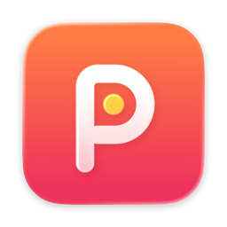
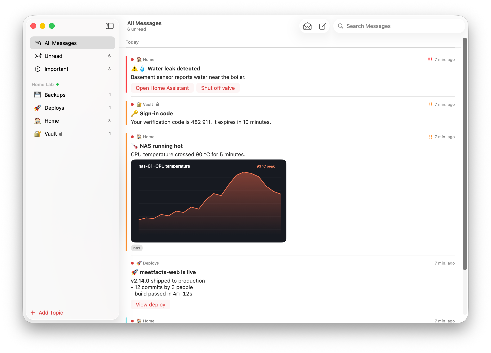
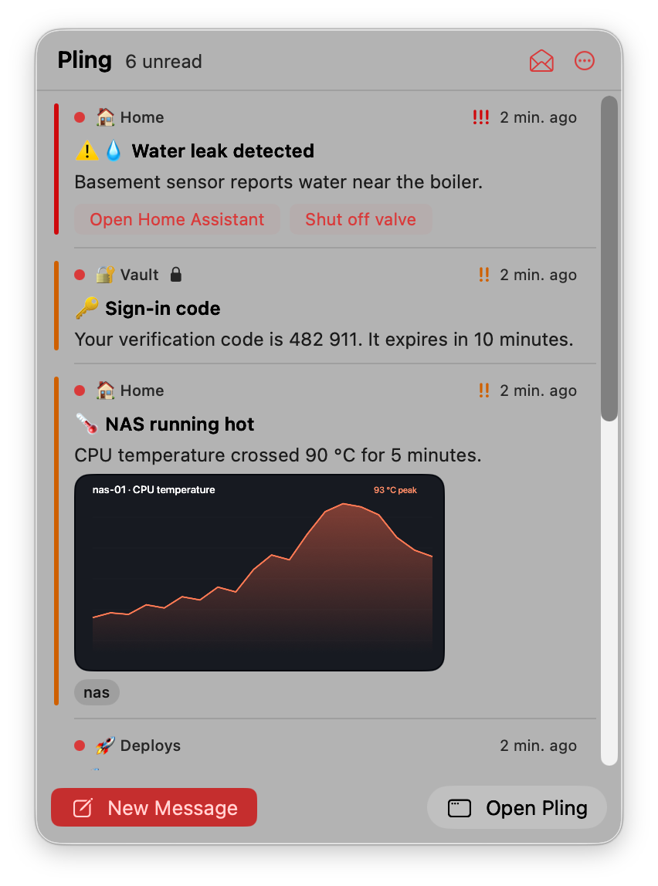
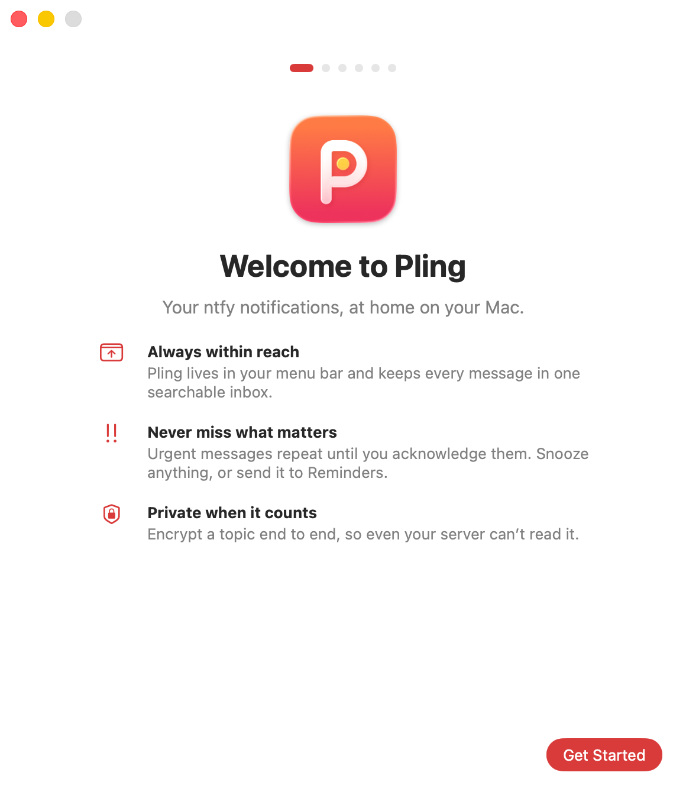

<div align="center">



# Pling

**Your [ntfy](https://ntfy.sh) notifications, at home on your Mac.**

A native macOS client for ntfy. It lives in your menu bar, keeps every message in a searchable inbox,<br>
and makes sure the urgent ones never slip by.

[](https://github.com/weidhaus/pling/releases/latest/download/Pling.zip)


<br>



</div>

<br>

<table>
<tr>
<td width="50%" valign="top">

### Always within reach
Click the **P** in your menu bar for your latest messages, with images, action buttons and snooze. A small dot means something's unread.



</td>
<td width="50%" valign="top">

### Set up in a minute
A guided first run connects your server, subscribes to topics, and asks for notifications and Reminders only when you get to that step.



</td>
</tr>
</table>

## Features

| | |
|---|---|
| 🔔 **Everything ntfy sends** | Priorities, emoji tags, Markdown, click links, icons, and attachments with inline image previews and Quick Look |
| 👆 **Action buttons** | `view`, `http` and `copy` actions, in the app and right in the notification |
| 🚨 **Urgent means urgent** | High and urgent messages repeat until you acknowledge them. Repeats replace the old banner instead of piling up. |
| ⏰ **Snooze & Reminders** | Remind me in 15 minutes, in 1 hour, or tomorrow morning, or send a message to any Apple Reminders list |
| 🗂️ **Many servers, many topics** | ntfy.sh and self-hosted servers side by side, with no auth, username & password, or access token, all stored in the Keychain |
| ✍️ **Publish** | ⌘N to send: title, Markdown, priority, tags, link, delayed delivery, file attachments |
| 🔐 **End-to-end encryption** | Per-topic passphrase. Your server only ever stores ciphertext (format below). |
| 🔕 **Quiet when you want** | Mute a topic for an hour, until tomorrow, or forever; set a minimum priority; global Do Not Disturb |
| 🔎 **Searchable history** | Every message is kept locally (one week to one year) with full-text search |
| 🔄 **Updates itself** | Signed, notarized builds with automatic updates via [Sparkle](https://sparkle-project.org) |

## Install

1. [Download the latest release](https://github.com/weidhaus/pling/releases/latest) and move **Pling.app** to Applications.
2. Open it and follow the setup.

Pling checks for updates automatically. You can also choose **Pling › Check for Updates…**.

> **Why does Pling keep running?** ntfy's instant push to Apple devices goes through a relay that only the official apps can use. Pling holds its own lightweight connection to each server instead: one HTTP stream per server. It reconnects after sleep or network changes and catches up on anything missed, so it starts at login by default.

## iPhone and iPad

Pling for iOS shares the Mac app's code: the same inbox, topics, compose, E2E encryption and swipe actions. iOS suspends apps in the background, and ntfy's own push relay only serves the official apps, so background notifications come from **pling-relay**, a small Go service in [`relay/`](relay) that runs next to your ntfy server:

1. In the Apple Developer portal, create an APNs key (Keys › Apple Push Notifications service) and save it as `relay/apns.p8`.
2. `cd relay && NTFY_PASSWORD=… APNS_KEY_ID=… docker compose up -d`. It joins ntfy's Docker network and listens on port 8080.
3. Expose it over HTTPS (reverse proxy or tunnel) and enter that URL under **Push Relay** in the server's settings in Pling.

Devices register with their own ntfy credentials. The relay checks read access for each topic with ntfy and doesn't store those credentials. It forwards encrypted messages as ciphertext, and Pling's notification extension decrypts them on the device. Without a relay, messages arrive while Pling is open.

## End-to-end encryption

ntfy has no built-in end-to-end encryption, so Pling defines a small, documented format. To set it up, open the topic's **Topic Settings** (the slider button in the toolbar), enter a passphrase, and share that passphrase with everyone on the topic.

| | Pling E2E v1 |
|---|---|
| **Key** | PBKDF2-HMAC-SHA256(passphrase, salt `"pling-e2e-v1:" + topic`, 600 000 iterations) → 32 bytes |
| **Cipher** | AES-256-GCM, random 96-bit nonce |
| **Plaintext** | JSON `{title, message, tags, priority, click, actions, markdown, attachment: {name, type, sha256}}` |
| **Body** | `pling:e2e:v1:` + base64url(nonce ‖ ciphertext ‖ tag), unpadded, ≤ 3072 bytes |
| **In the clear** | Only the title `🔒 Encrypted message` and the priority, so urgency still works |
| **Attachments** | Sealed the same way and uploaded as `attachment.bin`. The real name and type, and the hex SHA-256 of the sealed blob (optional; checked when present), are inside the encrypted body. |

Test vector: passphrase `correct horse`, topic `alerts` → key `3f4eb1b83ee4637da1ef28b964e6bccd1623c37654f4421ad70dbad6a6c735d4`.

### Send encrypted messages from scripts: `ntfy-e2e`

```sh
cd PlingCore && swift build -c release
cp .build/release/ntfy-e2e /usr/local/bin/

export NTFY_USER=me NTFY_PASSWORD=… PLING_E2E_PASSPHRASE=…
ntfy-e2e send --server https://ntfy.example.com --topic alerts \
  --title "Door" --priority 4 --tags door "Front door opened"

ntfy-e2e decrypt --topic alerts 'pling:e2e:v1:…'
```

<details>
<summary><b>Home Assistant example</b></summary>

```yaml
shell_command:
  pling_secret: >-
    NTFY_TOKEN=!secret ntfy_token PLING_E2E_PASSPHRASE=!secret pling_pass
    /config/bin/ntfy-e2e send --server https://ntfy.example.com --topic alerts
    --title "{{ title }}" --priority {{ priority | default(3) }} "{{ message }}"
```

</details>

## Build from source

```sh
brew install xcodegen
xcodegen generate
open Pling.xcodeproj
```

The project signs with the maintainer's Developer ID. For your own build, change `DEVELOPMENT_TEAM` and `CODE_SIGN_IDENTITY` in `project.yml`, or switch to "Sign to Run Locally".

```
PlingCore/        Swift package: ntfy client, message model, E2E crypto, ntfy-e2e CLI (swift test)
App/              SwiftUI app: menu bar panel, window, onboarding, settings, notifications
iOS/              iOS app entry, settings, push registration; Notify/ is the notification service extension
relay/            pling-relay: ntfy → APNs bridge for the iOS app (go test ./...)
scripts/          release.sh (Mac: notarize, Sparkle, GitHub release), testflight.sh (iOS)
```

Integration tests run against a real server when `PLING_TEST_SERVER`, `PLING_TEST_USER` and `PLING_TEST_PASSWORD` are set. Keep them in `.env.local`, which git ignores:

```sh
cd PlingCore && set -a && . ../.env.local && set +a && swift test
```

## Notes

- Priority 4 and 5 ask for *time-sensitive* delivery, so they can break through Focus. macOS honours that only with the Time Sensitive Notifications entitlement, which needs a provisioning profile. Without it, these arrive as normal notifications, and repeat alerts still apply.
- Emoji short codes come from [github/gemoji](https://github.com/github/gemoji) (MIT). Updates use [Sparkle](https://sparkle-project.org) (MIT).
- Pling is an independent project and isn't affiliated with ntfy.

## License

MIT © Justus-Constantin Weidhaus
